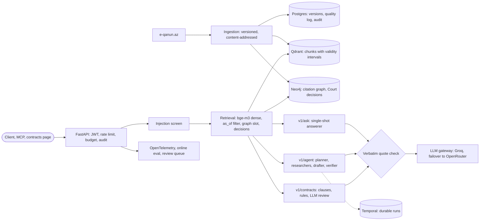

# Mizan

Agentic, measurable legal research platform for Azerbaijani law.

Mizan answers legal questions with citations to the exact article of the law in force at a
given date, verifies every claim against its source, and measures its own quality
continuously. See [docs/ROADMAP.md](docs/ROADMAP.md) for the full 24-week plan.

> **Status:** complete (F0–F11); video and hosted deployment deliberately out of scope. The technical report is
> [docs/REPORT.md](docs/REPORT.md): methodology, every result, and the negative results.
> The evaluation sets are published as [AzLegalBench](https://huggingface.co/datasets/NamiqKenan/azlegalbench) on Hugging Face.
> Mizan is a research aid, not legal advice.

## Architecture



## Results

Each row is a frozen or pre-registered measurement; details and confidence intervals are in
the linked reports.

| area | result | |
|---|---|---|
| retrieval (200 silver questions) | bge-m3 dense: Recall@5 **0.946**, MRR@10 0.894; hybrid, rerank and rewriting measured and off | [F2/F3](evals/results/f3_retrieval_v1/report.md) |
| answers (58 questions) | correct **0.914**; abstains on 4/4 out-of-scope; 0.84 of citations verbatim | [F3](evals/results/f3_generation/report.md) |
| citation graph (multi-hop, pre-registered) | Recall@5 **+0.075** and **+0.117** on two sets | [F4](evals/results/f4_graph/) |
| Constitutional Court decisions | correct 0.27 → **0.91** on the questions they govern | [F4](evals/results/f4_decisions/README.md) |
| multi-agent vs single-shot | correct **−0.118** (significant), citation accuracy 0.64 → 0.92 ❌ | [F5](evals/results/f5_agent/README.md) |
| fine-tuned embedder / distilled reranker | both gates missed ❌ | [F7](evals/results/f7_embed/README.md) |
| local 2B verifier (LoRA) | **98.4%** of the API's macro-F1, 7.3x cheaper ✅ | [F8](evals/results/f8_verifier/README.md) |
| semantic cache | 23.9% saved vs 25% target, ships off ❌ | [F9](evals/results/f9_cache/README.md) |
| prompt-injection screen | **98.2%** of held-out attacks blocked, 0/281 benign questions ✅ | [F10](evals/results/f10_redteam/README.md) |
| contract analysis (3 held-out sets) | recall 0.28 / 0.50 / 0.61 vs 0.70; DoD not met ❌ | [F10](evals/results/f10_contracts/test3/README.md) |
| load (1 process, CPU) | 0 errors; ~25 concurrent users; limit is query embedding (88 ms) | [F11](evals/results/f11_load/README.md) |

## Repository layout

```
apps/
  api/                 FastAPI gateway (deployable)
  worker/              Arq worker: scheduled ingestion (deployable; also runs migrations)
  mcp/                 MCP server for Claude Desktop and other agents (a thin API client)
packages/
  mizan-core/          settings, structured logging, tracing, health primitives
  mizan-ingestion/     e-qanun client, Word-HTML parser, temporal storage, chunking
    migrations/        Alembic migrations
  mizan-retrieval/     embeddings, BM25 analyser, Qdrant index, search, answering, retrieval eval
  mizan-evals/         generation eval: LLM judge, blind human labelling, Cohen's kappa
  mizan-graph/         citation extraction, temporal knowledge graph (Neo4j), graph-aware search
  mizan-agents/        multi-agent research: planner, researchers, drafter, verifier, judge
  mizan-contracts/     contract analysis: document reading and OCR, clauses, rules, LLM review
  mizan-train/         synthetic data, embedding / reranker / verifier fine-tuning, comparisons
docs/
  adr/                 architecture decision records
  REPORT.md            technical report: methodology, results, negative results
  DEPLOY.md            deployment guide        DEMO.md   demo script
  security/            OWASP LLM Top 10 audit
  ROADMAP.md
evals/                 datasets (silver questions, multi-hop, red team, contracts), results per phase
infra/                 observability config, GPU training scripts, load test (Locust),
                       AzLegalBench packaging for the Hugging Face Hub
compose.yaml           local stack: Postgres, Redis, Qdrant, Neo4j, migrate, worker, API
```

## Quick start

Requirements: [uv](https://docs.astral.sh/uv/), Docker.

```bash
cp .env.example .env
docker compose up -d --build        # full stack, API on http://127.0.0.1:18000
python run_mizan.py                 # or: start the stack, wait until ready, open the browser
curl http://127.0.0.1:18000/health/ready
```

Develop on the host against the dockerised services:

```bash
uv sync
docker compose up -d postgres redis qdrant neo4j
uv run uvicorn mizan_api.main:create_app --factory --reload --port 8080
```

Host ports default to the 1xxxx range (Postgres `15432`, Redis `16379`, Qdrant `16333`,
Neo4j `17687`, API `18000`) so the stack can run next to other local projects. Override them with
`MIZAN_HOST_PORT_*` in `.env`.

## Legal data (F1)

Source: [e-qanun.az](https://e-qanun.az), the official legal database of the Ministry of
Justice. Every consolidated version of a document is stored with its validity interval, so
any question can be answered *as of* a date ([ADR-0003](docs/adr/0003-temporal-versioning.md)).

```bash
uv run alembic upgrade head                                  # schema
uv run mizan-ingest sync 46943                               # Labour Code, all versions
uv run mizan-ingest as-of 46943 2021-06-01 --key art:69      # Article 69 as it stood then
uv run mizan-ingest inspect path/to/file.html                # parser statistics for one file
```

What the parser handles, all found in the real data:

- mixed encodings: files declare windows-1251 but some are windows-1254; detected per file;
- structure from layout: sections, chapters (Azerbaijani ordinals: "Qırx səkkizinci fəsil"),
  articles (`Maddə 7-1.`), parts, points, items, annexes with model forms;
- 25 years of format drift: `<h3>` vs bold headings, small-caps casing artefacts, endnote
  wording variants;
- amendment history: 625 endnotes, each linked to the amending act and its date.

Being polite to a public-service site is built in: an honest User-Agent, one request at a time,
at most one every 1.5 s, and historical versions are downloaded once and then served from disk.
The worker re-syncs tracked documents nightly; a re-run downloads only the current text and
writes nothing if it has not changed.

## Retrieval and answering (F2)

```bash
uv run mizan-retrieval index                         # embed + index all versions (resumable)
uv run mizan-retrieval search "Məni işdən qova bilərlər?" --as-of 2020-01-01
uv run mizan-retrieval eval                          # 17 variants, report in evals/results/
curl "http://127.0.0.1:18000/v1/search?q=sınaq+müddəti&as_of=2010-01-01"
curl -X POST http://127.0.0.1:18000/v1/ask -H "Content-Type: application/json" \
     -d '{"question": "İşdən çıxmaq üçün neçə gün əvvəl xəbər verməliyəm?"}'
```

- **Configuration chosen by measurement** ([ADR-0004](docs/adr/0004-retrieval-configuration.md)):
  dense bge-m3 over article chunks, filtered to the text in force on the requested date.
  Recall@5 **0.929** [0.87, 0.98], MRR 0.831, 376 ms p50 on a laptop CPU. Hybrid fusion,
  cross-encoder reranking and LLM query rewriting were all built and measured; none paid for
  itself on this question set, and each can be switched on by configuration.
- **Answers cite the statute verbatim.** `/v1/ask` uses Groq (`openai/gpt-oss-120b`) by
  default, or Claude with its native Citations API. With Groq, every quote the model returns
  is checked to occur in the source it names; unverifiable quotes are dropped and counted.
- Long articles are retrieved by part and answered from the whole article (parent-child).
- Set `MIZAN_LLM__GROQ_API_KEY` to enable `/v1/ask`; `/v1/search` needs no key.

## Evaluation (F3)

Two layers ([ADR-0005](docs/adr/0005-evaluation-methodology.md)):

- **Retrieval gate on every push.** CI rebuilds the index from a frozen, deterministic corpus
  snapshot (no database, no scraping), evaluates the serving configuration and compares it with
  a committed baseline by paired bootstrap. A change fails only when a metric's whole 95%
  interval is below zero, or Recall@5 falls under 0.75.
- **Generation eval before releases.** Retrieve, answer, then judge each answer against the
  gold provisions in force on the question's date. Mechanical checks (verbatim quotes, citing a
  gold article) are computed in code; only correctness is judged, by a different model from the
  answerer, and the judge is calibrated against blind human labels (Cohen's kappa >= 0.6).

```bash
uv run mizan-graph gate                           # what CI runs (dense + graph, F4)
uv run mizan-eval run --sample 60                 # paced for Groq's free tier, resumable
uv run mizan-eval report
uv run mizan-eval label --labeller <name>         # blind: the judge's verdict is never shown
uv run mizan-eval kappa                           # judge vs human agreement
```

## Knowledge graph (F4)

Articles cite each other ("bu Məcəllənin 70-ci maddəsinin “b” bəndi"). A grammar extracts the
citations (633 in the current text, none unresolved), and each becomes a temporal edge in
Neo4j, valid while the citing text is in force ([ADR-0006](docs/adr/0006-knowledge-graph.md)).
Search keeps the dense ranking and gives the 5th place to the most similar article the best hit
cites. If Neo4j is down, search falls back to dense results.

Constitutional Court decisions are part of the law in force. They are ingested with the acts
the Code links to, linked to the articles they rule on, and added to the context of `/v1/ask`.
The consolidated text can lag behind them: Art. 144(3) was suspended on 2026-02-18 and still
reads the same. Conflicts between norms are resolved by the collision rules of the
Constitutional Law "Normativ hüquqi aktlar haqqında" (`mizan_graph.conflicts`).

```bash
uv run mizan-ingest linked                        # register linked acts, store court decisions
uv run mizan-ingest diff 46943 art:69 2020-01-01 2026-10-01   # also GET /v1/diff
uv run mizan-graph build                          # extract citations, rewrite the graph
uv run mizan-graph neighbours art:70              # who cites Art. 70, what it cites
uv run mizan-graph eval                           # dense vs graph policies on v1 + multi-hop sets
uv run mizan-graph gate                           # what CI runs: the serving path vs baseline
```

## Agents (F5)

`POST /v1/agent/ask` (and `/v1/agent/ask/stream`, SSE) runs a typed state machine
([ADR-0007](docs/adr/0007-agent-orchestration.md)):

1. A planner rewrites the question into the Code's terms.
2. Researchers search, follow exceptions in the citation graph, add court decisions, and apply
   the collision rules. They are deterministic tools, with no LLM.
3. A drafter answers claim by claim, each claim with a verbatim quote.
4. A verifier checks every quote mechanically and every claim against its source.
5. A judge answers, abstains, or researches again.

An LLM gateway handles routing, retries with backoff, a circuit breaker, a token budget per run
and per tenant per day.

## Observability (F6)

```bash
docker compose --profile observability up -d     # ClickHouse, OTel Collector, Grafana :13000
MIZAN_TELEMETRY__OTLP_ENDPOINT=http://127.0.0.1:14318 uv run uvicorn mizan_api.main:create_app --factory
uv run mizan-eval drift                           # exit 1 on faithfulness drift / SLO breach
```

Every request is one trace, built from OpenTelemetry GenAI spans:
- `invoke_agent` for agent steps;
- `execute_tool` for tool calls;
- `chat` for LLM calls, with tokens, estimated cost and prompt version.

Spans are stored in ClickHouse for 30 days, and PII is redacted in code and again in the
Collector. Every answer is logged with an `answer_id` for `POST /v1/feedback`. 5% of answers
are judged for faithfulness online by an independent model. Drift and SLO alerts run both in
code and in Grafana ([ADR-0008](docs/adr/0008-observability.md)).

## MCP server (F9)

`mizan-mcp` exposes Mizan to MCP clients over stdio:

- `search_law`: provisions relevant to a question, in force on a date;
- `get_article`: a whole article on a date, with the Constitutional Court decisions that
  interpret it;
- `check_conflicts`: which of several articles prevails, under lex specialis and voided provisions;
- `ask_mizan`: a sourced answer, with every quote checked against its source.

The server is a thin client of the HTTP API. It holds no models, databases or LLM keys, so every
call goes through the API's tenant budget, tracing and quality loop.

Claude Desktop (`claude_desktop_config.json`), with the API running:

```json
{
  "mcpServers": {
    "mizan": {
      "command": "uv",
      "args": ["--directory", "C:/path/to/Mizan", "run", "mizan-mcp"],
      "env": { "MIZAN_API_URL": "http://127.0.0.1:18000", "MIZAN_TENANT_ID": "desktop" }
    }
  }
}
```

## Durable agent runs (F9)

With `MIZAN_DURABLE__ENABLED=true`, `/v1/agent/ask` and `/v1/agent/ask/stream` run on Temporal
([ADR-0011](docs/adr/0011-durable-agent-runs.md)).

- Each step (plan, research, draft, verify) is an activity. A run whose worker dies continues
  on another worker from the step that was running, without repeating finished LLM calls.
- An `Idempotency-Key` header makes a retried request join its run, or return its answer,
  instead of paying for a new one.

```bash
docker compose --profile durable up -d temporal   # UI: http://127.0.0.1:18233
uv run mizan-agent-worker                          # any number of workers
MIZAN_DURABLE__ENABLED=true uv run uvicorn mizan_api.main:create_app --factory
```

## Authentication and multi-tenancy (F9–F10)

See [ADR-0012](docs/adr/0012-tenancy-and-access.md).

- **Authentication:** with `MIZAN_AUTH__ENABLED=true` (required in staging and production),
  every `/v1` request needs `Authorization: Bearer <JWT>`.
  - Tokens are HS256, signed with `MIZAN_AUTH__JWT_SECRET` (at least 32 characters).
  - They carry the subject, the tenant and the scopes: `ask` for the LLM endpoints, `review`
    for the review queue. Operators issue them with
    `uv run mizan-token --subject alice --tenant acme --scopes ask --days 30`.
- **Rate limit:** `MIZAN_AUTH__REQUESTS_PER_MINUTE` per subject (default 60). Over the limit,
  the API answers `429` with `Retry-After`.
- **Audit log:** every `/v1` request, refused ones included, becomes an append-only
  `audit_log` row: subject, tenant, path, status, outcome and trace id.
- **MCP:** the MCP server sends `MIZAN_API_TOKEN` when it is set.


- **Tenant id:** with auth on, it comes from the token. With auth off (local development), it
  comes from `X-Tenant-Id`, falling back to `public`.
- **Quota:** a daily token budget per tenant, in Redis (`MIZAN_LLM__DAILY_TOKENS_PER_TENANT`).
  The API answers `429` with `Retry-After` when it is spent.
- **Row-level security:** `answers` is protected in Postgres. Every session of the quality loop
  works as the role `mizan_app` (no superuser, no `BYPASSRLS`) and sets `mizan.tenant` for its
  transaction.
  - Other tenants' rows are invisible and cannot be written.
  - An unset tenant sees nothing (fail closed). `*` is the reviewer/analytics scope.
  - Feedback, online evals, reviews and shadow runs are reached through their foreign key to
    `answers`. A query that reads them without joining `answers` is not filtered.
- **Limitation:** the API still logs in as the database owner and switches role per
  transaction (`SET LOCAL ROLE`). A bug that skips `as_tenant` would therefore run unfiltered.
  In production the API should log in as `mizan_app` itself, so that the owner role is used
  only by migrations.

## Contract analysis (F10)

See [ADR-0013](docs/adr/0013-contract-analysis.md).

Upload an employment contract at `http://127.0.0.1:18000/contracts` (or
`POST /v1/contracts/analyze`, multipart `file`). The report lists every clause as OK, risk,
violation or suspicious instruction, with the article and a verified quote of the law.

- **Formats:** PDF, DOCX, plain text and photos. Scanned pages are read by a vision model
  (`MIZAN_CONTRACTS__OCR_MODEL`).
- **Two layers:**
  - Deterministic rules cover the numeric limits of the Labour Code: probation, working hours,
    overtime, leave, wages in kind or in foreign currency, deductions, notice and protected
    dismissals.
  - An LLM reviews the remaining clauses against retrieved articles. A finding is kept only if
    its quote occurs verbatim in the cited article.
- **Hidden instructions** inside a contract are flagged, not obeyed, and never reach a model.
- **Evaluation:** `uv run mizan-eval contracts` scores the rules on the synthetic contract set,
  and CI fails if one stops firing; `--llm` measures the LLM layer
  ([results](evals/results/f10_contracts/README.md)).

## Security (F10)

- **Prompt injection.** Questions are screened before any spend, and attacks get `400`. The
  screen is a pre-registered CI gate: 98.2% of test attacks blocked, 0 of 281 real questions
  blocked ([report](evals/results/f10_redteam/README.md)).
  - Untrusted text is neutralised, and sources are delimited as data.
  - Outputs are schema-checked JSON, and every quote is checked against its source.
  - An answer that reproduces a system prompt is replaced by a refusal.
- **OWASP Top 10 for LLM applications:** [audit](docs/security/owasp-llm-top10.md). 8 risks
  are controlled and 2 are partial, with next steps.

## Quality gates

| Command | What it checks |
|---|---|
| `uv run ruff check .` | lint, import order, security (bandit rules), async pitfalls |
| `uv run ruff format --check .` | formatting |
| `uv run mypy packages apps` | strict typing |
| `uv run pytest --cov` | unit tests + coverage |
| `MIZAN_INTEGRATION=1 uv run pytest -m integration` | real Postgres: migrations + `alembic check`, ingestion pipeline end to end, dependency checks |
| `uv run mizan-eval redteam --gate` | prompt-injection screen vs the pre-registered red-team test split |
| `uv run mizan-eval contracts --gate` | contract rules: no regression on the development contracts |
| `uv run mizan-graph gate` | quality of the serving path (dense + graph) vs the committed baseline (paired bootstrap) |

All of the above run in CI ([.github/workflows/ci.yml](.github/workflows/ci.yml)), followed by a
Docker image build. Install the git hooks once with `uv run pre-commit install`.

## Operational conventions

- **Configuration:** environment variables only, prefix `MIZAN_`, nested with `__`
  (`MIZAN_POSTGRES__HOST`). Development secrets are rejected at startup in staging/production.
- **Health:** `/health/live` never touches dependencies; `/health/ready` checks every backing
  service concurrently with a per-check timeout and returns `503` if any is down. Error details
  go to logs, not to the response.
- **Tracing:** every response carries `X-Trace-Id`; incoming W3C `traceparent` headers are
  continued. Every log line carries `trace_id` / `span_id`. Set
  `MIZAN_TELEMETRY__OTLP_ENDPOINT` to export spans to Jaeger / Tempo.
- **Logs:** JSON in containers, human-readable on the host. Liveness-probe access logs are dropped.

## Decisions

| ADR | Decision |
|---|---|
| [0001](docs/adr/0001-monorepo-and-stack.md) | uv workspace monorepo; FastAPI, Pydantic, structlog, OpenTelemetry |
| [0002](docs/adr/0002-vector-database.md) | Qdrant for retrieval, Postgres as source of truth |
| [0003](docs/adr/0003-temporal-versioning.md) | Versioned snapshots with derived validity intervals; content-addressed text |
| [0004](docs/adr/0004-retrieval-configuration.md) | Dense bge-m3, article chunks; hybrid, reranking and rewriting measured and left off |
| [0005](docs/adr/0005-evaluation-methodology.md) | Versioned datasets, mechanical metrics first, calibrated judge, CI retrieval gate |
| [0006](docs/adr/0006-knowledge-graph.md) | Grammar-extracted temporal citation graph in Neo4j (derived, rebuildable); one reserved top-5 slot, pre-registered test |
| [0007](docs/adr/0007-agent-orchestration.md) | Own typed state machine; LLMs only for planning, drafting, verification; gateway owns reliability |
| [0008](docs/adr/0008-observability.md) | OTel GenAI spans → Collector → ClickHouse; quality loop (answers, feedback, online evals) in Postgres |
| [0009](docs/adr/0009-model-serving.md) | Public bge-m3 dense retrieval, no reranker; trained models stay gated local artefacts |
| [0010](docs/adr/0010-local-vs-api-models.md) | Narrow, high-volume tasks go local only past a pre-registered gate and the GPU break-even; verification stays on the API for now |
| [0011](docs/adr/0011-durable-agent-runs.md) | Durable agent runs on Temporal (opt-in): one state machine, steps as activities, idempotent request ids |
| [0012](docs/adr/0012-tenancy-and-access.md) | JWT identity with scopes, tenant from the token only; Postgres RLS; per-subject rate limit; append-only audit log |
| [0013](docs/adr/0013-contract-analysis.md) | Contract analysis: rules for numeric limits, LLM review for the rest, every finding quoting the law; injected clauses reported, never sent |

## Disclaimer

Mizan is a research tool and does not provide legal advice.
